# JARVIS AI Assistant

Fedora desktop assistant with speech, local AI, and desktop controls.

## What it does

- Wake word, speech recognition, and text to speech.
- Local model responses through Ollama, with optional API services.
- Desktop interface, plugins, and REST or WebSocket APIs.

## Getting started

Copy `.env.example` to `.env` and configure the services you use. Run `scripts/setup.sh`, start Ollama if using a local model, then use the project launch command described in the source configuration.

## Security

Keep credentials in local environment files. The example files contain placeholders only. Rotate any credential previously used in a local deployment before publishing or redeploying.
